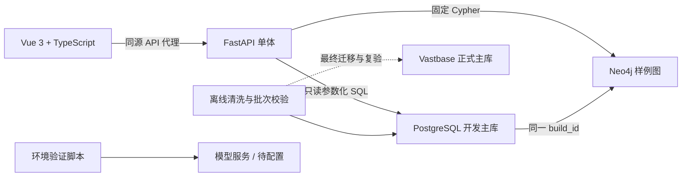
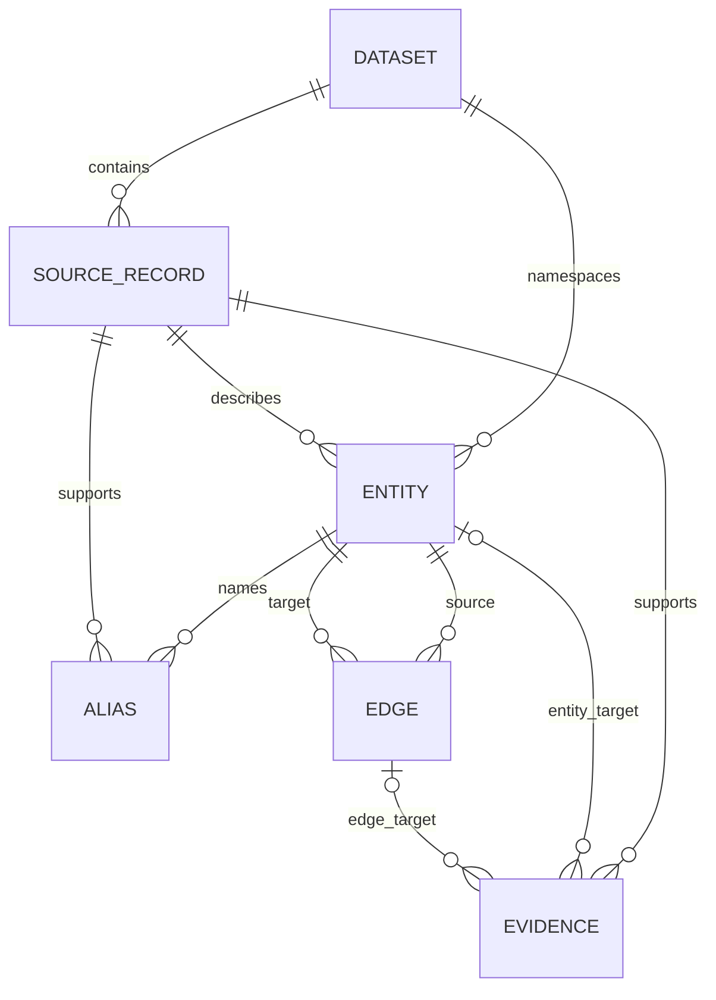

# QiHuang-KG 架构与数据模型

版本：2.0。修订日期：2026-10-04。范围以[首版冻结说明](scope-freeze.md)为准。[历史架构 v1](architecture-v1.md)保留原 SQLite 设计，不再作为当前存储和功能边界依据。

## 当前结构

页面和 API 接入真实 PostgreSQL 与 Neo4j。模型调用只由环境脚本显式触发，业务 AI 入口尚未开放。健康检查读取最近一次模型调用结果，不发起计费请求。

| 模块 | 实现 | 职责 |
| --- | --- | --- |
| 数据准备 | `scripts/prepare_data.py` | 标准化、修复、去重、证据和不可变批次 |
| 关系库导入 | `scripts/import_vastbase.py` | 显式选择 PostgreSQL/Vastbase，环境探测与事务导入 |
| 本地环境 | `scripts/setup_services.py`、`compose.yaml` | 私有凭据、批次选择、持久化数据库 |
| 环境验证 | `scripts/verify_environment.py` | 真实约束、索引、回滚、图样例和可选模型调用 |
| 数据访问 | `backend/services.py` | 批次检查、只读 SQL、固定 Cypher、错误隔离 |
| 模型传输 | `backend/model_client.py` | 超时、输出限制、JSON 协议、错误脱敏 |
| API | `backend/app.py` | 健康、统计、名称检索与固定图样例 |
| 页面 | `frontend/src/App.vue` | 实际数据展示、查询、依赖状态、空结果及错误 |

每个关系库请求建立一个只读连接，SQL 超时 3 秒。后续根据实测并发引入连接池。应用以只读账号 `qihuang_reader` 连接，导入账号只供脚本使用。当前没有在线写入接口、认证或后台任务。

## 关系模型

[共享 v2 DDL](schema-vastbase.sql)面向 PostgreSQL 和最终 Vastbase，JSON 保存为经过校验的 UTF-8 `TEXT`。SQLite 仅是离线清洗快照。

`build` 保存批次、输入哈希和清单。每次发布建立独立 `qihuang_<build_id前24位>` schema，七张表在一个事务中导入、核对后提交，旧版本不覆盖。

| 表 | 关键内容与约束 |
| --- | --- |
| `dataset` | 来源 ID、版本、出处、许可声明与署名 |
| `source_record` | 文件哈希、记录键、行号/JSON 定位和原始内容；来源+文件+键唯一 |
| `entity` | 稳定 ID、类型、名称、搜索字段、属性、来源及审核状态；来源+类型+原键唯一 |
| `alias` | 实体、名称、规范名、来源及字段定位；仅表示来源声明 |
| `edge` | 稳定 ID、源、关系、目标、原始属性和冲突状态；三元组唯一 |
| `evidence` | 恰好关联实体或关系之一，附来源、字段定位、证据类型与可选引文 |
| `build` | 构建 ID、模型版本、转换版本、创建时间和完整清单 |

实体固定为 `herb`、`formula`、`pattern`、`text`、`tcm_term`、`patent_medicine`、`herbal_piece`、`icd11_code`、`medicinal_property`。不同类型或来源的同名实体不自动合并。

| 关系 | 源类型 | 目标类型 |
| --- | --- | --- |
| `CONTAINS` | `formula` | `herb` |
| `ASSOCIATED_WITH_PATTERN` | `formula` | `pattern` |
| `CITED_IN` | `formula / herb` | `text` |
| `ASSOCIATED_WITH_TERM` | `patent_medicine` | `tcm_term` |
| `HAS_HERBAL_PIECE` | `patent_medicine` | `herbal_piece` |
| `MAPPED_TO_ICD11` | `patent_medicine` | `icd11_code` |
| `HAS_MEDICINAL_PROPERTY` | `herbal_piece` | `medicinal_property` |

当前为 20,374 实体、179,502 业务关系、291,305 证据。证据、别名、日志和镜像不重复计入十万条口径。剂量不换算，冲突字段不猜测，未收录书目保留文字但不生成悬空边。

## 图模型与批次

当前 Neo4j 保存四君子汤样例：6 个 `Entity` 节点、5 条 `LINK` 关系和一个投影元数据节点。图数据库不是业务维护入口。

| 对象 | 属性 |
| --- | --- |
| `Entity` | 与主库一致的 `id`、`build_id`、`label`、`type`、`scope=bootstrap` |
| `LINK` | 与主库一致的 `id`、`build_id`、白名单 `relation`、`evidence_ids`、`scope=bootstrap` |
| `Projection` | `build_id`、`scope`、`complete`、节点/关系数量和源数据摘要 |

节点的 `(build_id,id)`、投影的 `(build_id,scope)` 使用唯一约束。关系按端点和稳定 ID 在事务中 `MERGE`，逐条比对主库样例后才将投影标记完整。应用只读取所配置批次，找不到完整样例时返回 503。

关系语义作为 `LINK.relation` 白名单属性保存，查询按属性筛选；客户端不能提交任意 Cypher、标签或路径长度。正式全量图投影将复用稳定 ID 与证据 ID，另行验证全量数量、摘要、旧版本隔离和备份恢复。

## 已实现接口

| 方法与路径 | 输入与输出 |
| --- | --- |
| `GET /api/v1/health/live` | 进程存活，200；不访问外部服务 |
| `GET /api/v1/health` | 主库、图库、模型状态；主库失败503；图/模型未就绪时200且 `degraded` |
| `GET /api/v1/stats` | 实际实体、关系、证据、分类计数、来源与 `build_id` |
| `GET /api/v1/entities` | `q` 最多100字，`type` 白名单，`dataset` 为 `bencaodian`/`tcm-mkg`，`limit` 1～50，`offset` 0～10000；按命中级别排序，每项带 `match`；返回 `items/total/limit/offset/build_id` |
| `GET /api/v1/graph/sample` | 固定样例的节点、关系、证据 ID 与批次；`scope=bootstrap` |
| `GET /api/v1/entities/{id}` | 实体属性、别名、关系汇总、前 20 条实体证据与总数 |
| `GET /api/v1/entities/{id}/evidence` | 按证据类型和字段定位稳定分页，`limit` 1～50、`offset` 0～10000 |
| `GET /api/v1/evidence/{id}` | 实体或边的目标、JSON Pointer 原值、来源记录与许可署名 |
| `GET /api/v1/entities/{id}/relations` | `relation` 与 `direction` 必填；邻居分页，每项带边属性、质量状态、证据 ID 和邻居分类 |
| `GET /api/v1/relation-queries` | 七个固定模板（见 spec §4.5）；返回本页路径、节点、边、原始属性和有序证据 ID，两跳模板附固定说明 |
| `GET /api/v1/datasets` | 来源、版本、许可、署名及每个来源的实体、关系、来源记录数 |

检索针对规范名称和来源别名，`%`、`_` 转义为字面字符。命中分五级：名称精确、别名精确、名称前缀、别名前缀、子串；每个实体只出现一次，同级按规范名的码位顺序与 ID 排序。SQL 参数绑定；schema 来自受校验的本地配置并以驱动标识符引用。所有错误统一为 `{"error":{"code":"…","message":"中文提示"}}`，不回传 SQL、路径、凭据或底层异常。映射集中在 `services.ERROR_STATUS`；依赖错误默认 503。

| HTTP | 错误码 |
| --- | --- |
| 404 | `entity_not_found`、`evidence_not_found`、`not_found` |
| 405 | `method_not_allowed`（保留 Allow 响应头） |
| 409 | `snapshot_changed` |
| 422 | `invalid_query`（含参数校验）、`invalid_type`、`unsupported_entity_type` |
| 500 | `evidence_pointer_invalid`、`internal_error` |
| 503 | `database_unavailable`、`build_mismatch`、`*_not_configured`、`invalid_app_config` 等依赖错误 |

四个 M1a 接口接受可选 `build_id`，不匹配时拒绝请求，成功响应均包含实际读取批次。实体 ID 只接受两个来源、九种类型和 1～160 位键；证据 ID 与批次 ID 限定为小写十六进制。非法参数在建立数据库连接前拒绝。

每个新请求在一个 `services.relational()` 可重复读事务中完成所有查询；继续使用只读事务、3 秒语句超时和库内批次核对。关系模板仅加载单实体的组成关系，当前最多 61 条，在内存中分页；数据规模变化时再将分页移入 SQL。

证据排序为 `source_quote → curated → bibliographic → auto_extracted → rule_inferred`，其次字段指针非空优先、指针字典序和 ID。JSON Pointer 支持 `~0`/`~1`，无效指针返回 500。来源文件名不含服务器目录；原始 JSON 超过 64 KB 时返回 `content=null` 和 `content_truncated=true`，引用字段 `raw_value` 保持原值。

来源目录、通用关系列表、任意根节点局部图以及 `/ai/query`、`/ai/explain` 尚未实现。后续单次局部图最多50节点、100关系的需求不由当前固定样例替代。

## 模型边界

私有配置指定服务端 OpenAI 兼容地址、模型、密钥、超时和输出上限。远程必须 HTTPS，本机模型可用 HTTP。客户端请求 `chat/completions` 的 JSON 模式，再验证完整结束状态、JSON、字段及证据 ID。

环境验证包括“检索四君子汤 → 白名单条件”和“主库组成材料 → 引用解释”。引用只能来自本次取出的证据；连接与契约测试不代表完整 AI 产品或内容验收。缺配置、超时、限额、拒答和格式失败各有独立状态，无自动重试。

健康接口返回最近一次匹配配置指纹的模型验证时间与结果，不承诺实时可用。正式 AI 功能还需输入范围判断、结构化事实校验、失败回退和冻结评测集。

接口依据：[OpenAI 结构化输出文档](https://developers.openai.com/api/docs/guides/structured-outputs)、[Neo4j Python 连接文档](https://neo4j.com/docs/python-manual/current/connect/)。实际兼容性以目标服务实测为准。

## 运行与最终迁移

启动步骤及端口见[第一阶段说明](bootstrap.md)。凭据不进入前端、Git 或报告。所有开发服务监听回环地址。应用只读事务和独立只读账号均已验证：该账号显式开启读写事务后，INSERT、UPDATE、DELETE、CREATE 仍以 `42501` 失败，见 `docs/acceptance/m1-readonly.json`。

主库故障使数据请求不可用，Neo4j 只影响图，模型未就绪不阻塞检索。全量投影尚未实施，不能宣称整个双库已完全同步。

最终迁移复用标准化批次、DDL 和导入校验工具，实测 Vastbase 驱动、约束、事务与查询性能。比对两库摘要后修改应用数据库类型和连接配置，保持图的 `build_id` 一致，再复验完整接口。详见[迁移说明](vastbase-import.md)。
