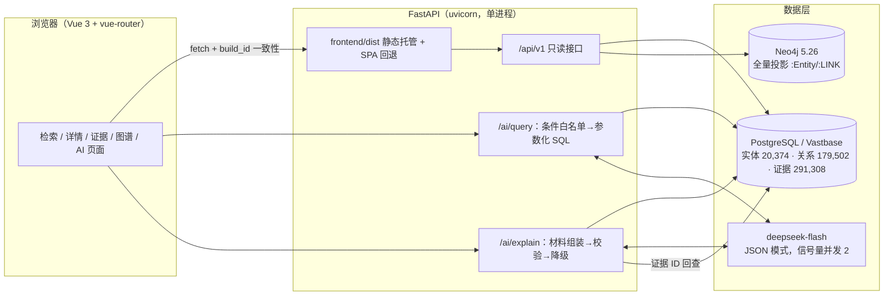
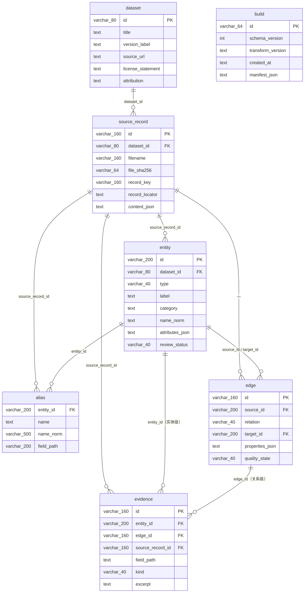
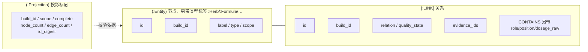
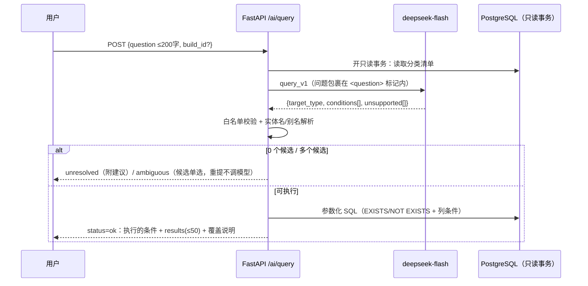
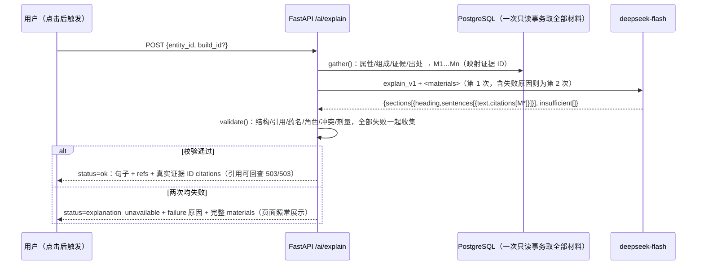

# 论文用图（Mermaid 源码，m7-spec §4）

图源可直接在支持 Mermaid 的编辑器渲染导出。所有数字取自验收记录文件（括号内为字段路径），**引用时以文件当前内容为准**，不在此手抄后修改；下方"记录值"为 2026-11-02 撰写时的快照，仅供对照。

## 1. 系统架构图

## 2. ER 图（关系库 7 张表）

## 3. Neo4j 图模型

## 4. AI 链路一：自然语言条件查询（/ai/query）

## 5. AI 链路二：带引用的方剂解释（/ai/explain）

## 6. 评测结果表（数字引用报告文件）

| 指标 | 值的来源（文件 → 字段） | 记录值（2026-11-02 快照） | 门槛 | 达标 |
| --- | --- | --- | --- | --- |
| 查询通过率（test） | `docs/acceptance/m5-eval-test.json` → `metrics.query.passed/total/rate` | 25/25 = 1.0 | ≥ 0.90 | ✅ |
| 解释完成率（test） | 同上 → `metrics.explain.ok/total/rate` | 19/20 = 0.95 | ≥ 0.90 | ✅ |
| 引用可回查率 | 同上 → `metrics.explain.citations_resolved/citations_total` | 503/503 = 1.0 | 1.0 | ✅ |
| 对抗样本（全部/关键） | 同上 → `metrics.adversarial` | 15/15；关键 13/13 | 全部 | ✅ |
| 事实支持率 | 同上 → `metrics.fact_support`（`--score-review` 生成） | 待人工审核（审核表 301 句） | ≥ 0.95 | 待人工 |
| 解释唯一降级样本 | 同上 → `samples[T-E15]`，原因见 `docs/dev/issues.md` I-002 | 模型编造剂量被校验拦截 | — | 设计行为 |

## 7. 性能表（数字引用报告文件）

| 接口组 | 值的来源 | 记录值（2026-11-02 快照） | 目标 | 达标 |
| --- | --- | --- | --- | --- |
| 12 个非 AI 接口 × 并发 1/5 | `docs/acceptance/m6-bench.json` → `endpoints[]` 的 `p95_ms` | 全部 ≤ 185 ms | ≤ 2000 ms | ✅ |
| `/ai/query` | 同上 → `ai[name=ai_query].p95_ms` | 约 1.4–1.6 s | ≤ 15 s | ✅ |
| `/ai/explain` | 同上 → `ai[name=ai_explain].p95_ms` | 约 18–20 s | ≤ 15 s | ❌ 已接受（I-004：模型生成时延） |
| 并发挤占信号量 | 同上 → `ai_busy_probe` | 5 并发 → 2 成功 + 3 `model_busy` | 设计行为 | ✅ |
| Vastbase 验收 | `docs/acceptance/m6-vastbase.json` → `status` | blocked（无实例，I-003） | passed | 阻塞外部 |

## 8. 恢复与部署验证（数字引用报告文件）

| 演练 | 证据文件 | 结论 |
| --- | --- | --- |
| 关系库恢复 → 只读账号 → 接口复验 → 清理 | `docs/acceptance/m7-recovery.json` → `steps[relational_restore|reader_setup|api_recheck|cleanup]` | 6/6 通过；table_sha256 与主库一致；写入全被 42501 拒绝 |
| Neo4j dump/load + 投影复用 | 同上 → `steps[graph_restore]`；`m3-backup-restore.json` | 20,374/179,502 节点边，摘要一致，`reused` |
| 构建产物由 FastAPI 托管 | 同上 → `steps[deploy_check]`；`tests/test_deploy.py` | 三个深链接刷新正常，无仓库文件泄露 |
